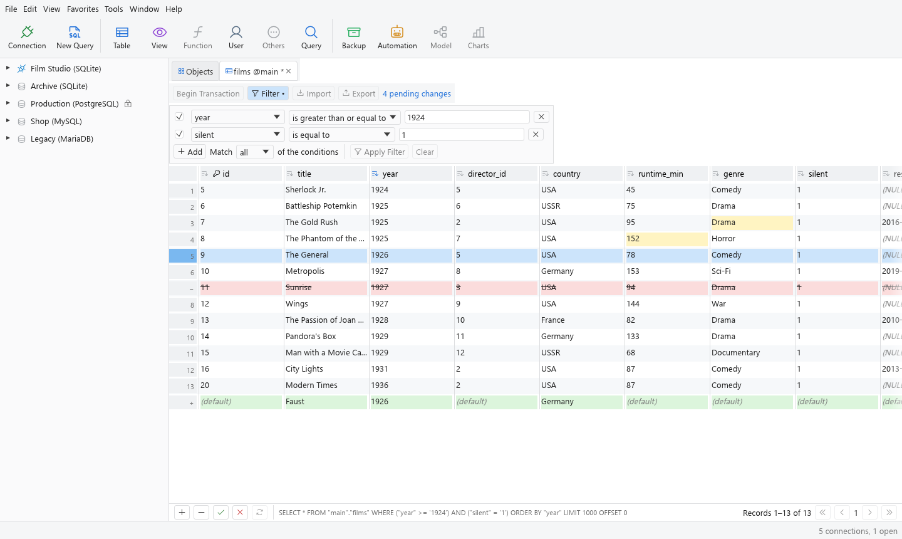
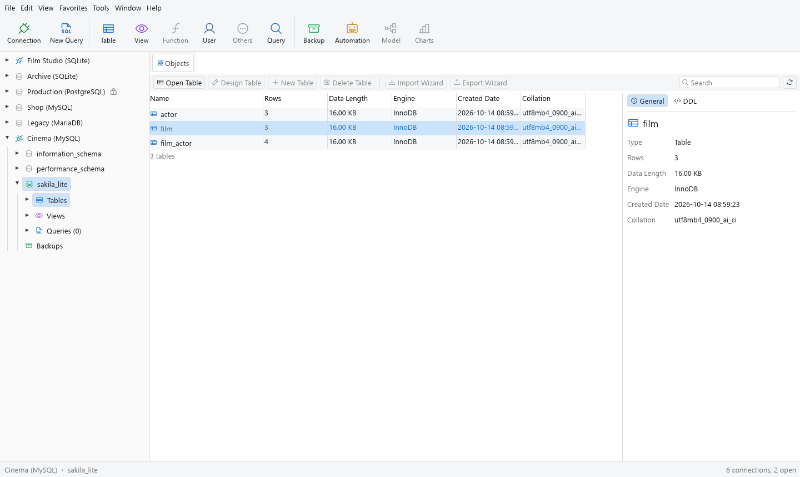
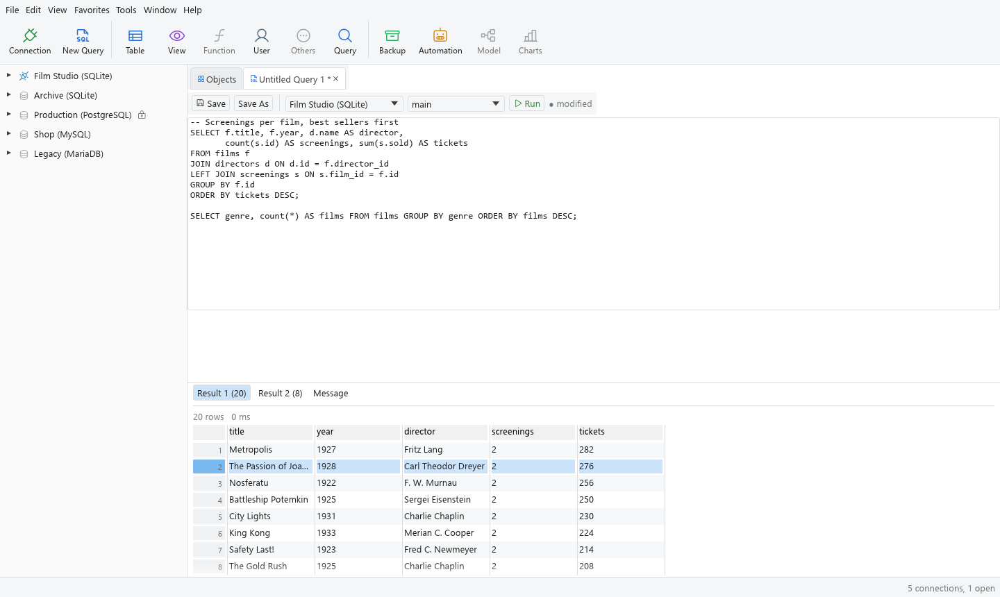
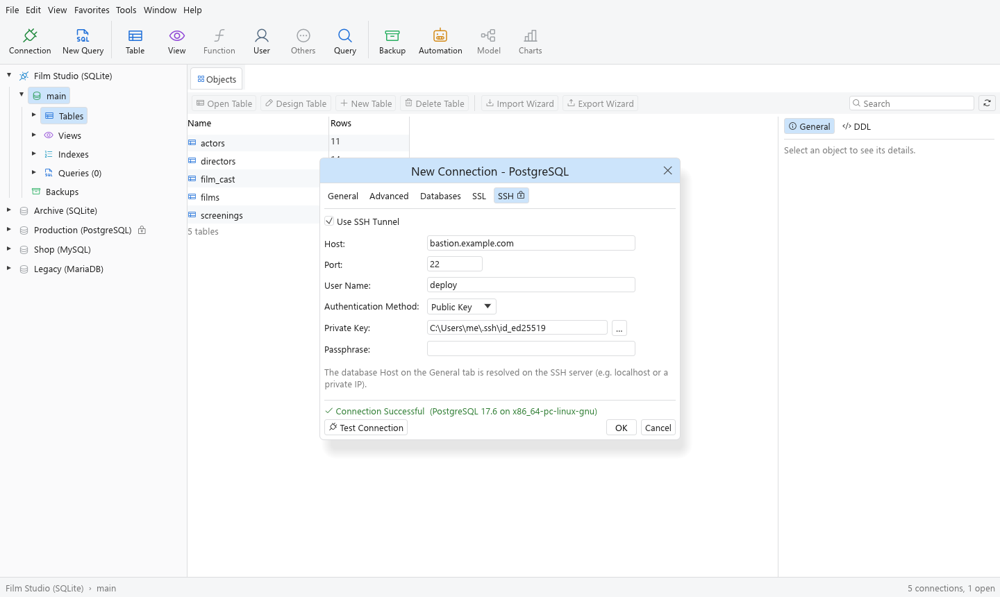
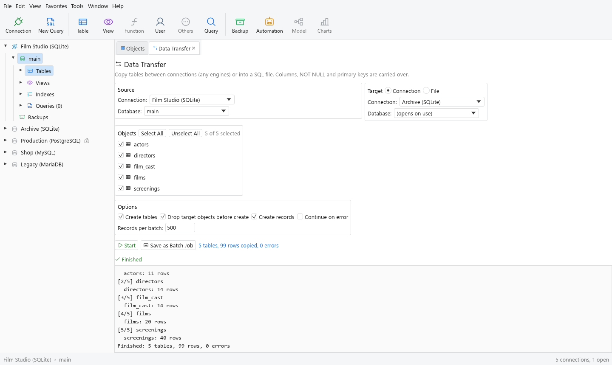
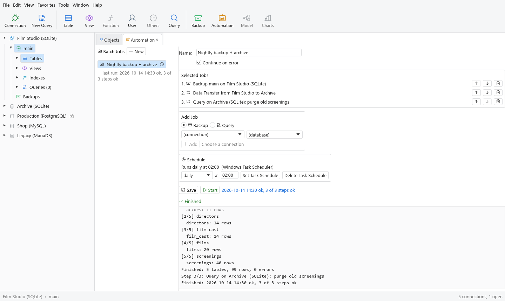
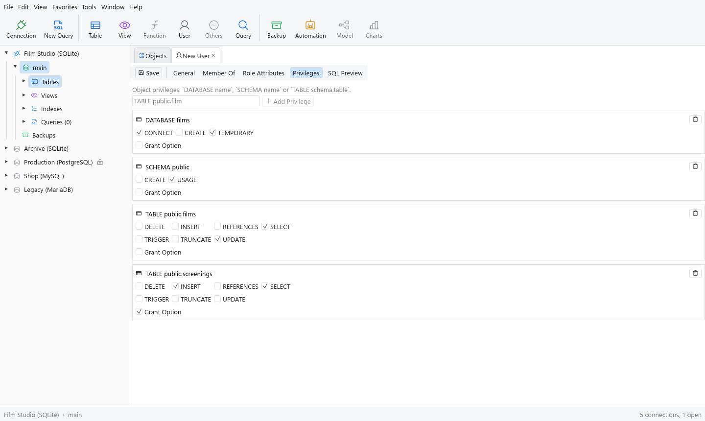
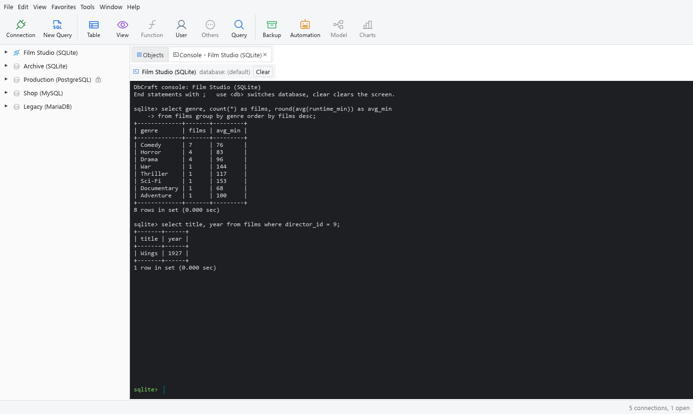

<h1 align="center">DbCraft</h1>

<p align="center">
  <b>A native database manager in pure Rust, built to match Navicat Premium.</b><br>
  Connections, an object browser, a live-editing data grid, a SQL editor, Data Transfer, Backup,<br>
  Automation and user management for SQLite, PostgreSQL, MySQL and MariaDB. No Electron, no web view.
</p>

<p align="center">
  
  
  
  
</p>

<p align="center">
  
  <br>
  <sub>The table viewer: filter, sort, edit in place. Pending edits are yellow, a new record green, a deleted one red; Apply writes them in one transaction.</sub>
</p>

<p align="center">
  <a href="#features">Features</a> ·
  <a href="#everything-in-the-box">Everything in the box</a> ·
  <a href="#built-for-agents">Agents</a> ·
  <a href="#under-the-hood">Under the hood</a> ·
  <a href="#get-started">Get started</a> ·
  <a href="ROADMAP.md">Roadmap</a>
</p>

<br>

<table>
  <tr>
    <td width="25%" valign="top">
      <h3>🗂️ Familiar by design</h3>
      The toolbar, connection tree, Objects tab, info pane, dialogs and shortcuts are where a Navicat user expects them, from Ctrl+R to Ctrl+S.
    </td>
    <td width="25%" valign="top">
      <h3>⚡ Native and fast</h3>
      One small native app on egui and wgpu. It starts instantly and pages through big tables without a browser engine in the way.
    </td>
    <td width="25%" valign="top">
      <h3>🔐 Real connections</h3>
      SQLite files, PostgreSQL, MySQL and MariaDB servers, directly or through an SSH tunnel (password or private key), with Test Connection.
    </td>
    <td width="25%" valign="top">
      <h3>🤖 Agent-ready</h3>
      Every action is a command, so the same engine runs from the UI, the <code>dbcraft-cli</code> command line or an MCP server for AI agents.
    </td>
  </tr>
</table>

<br>

## Features

Every screenshot is the real app, rendered offscreen from a scripted demo (`cargo run -p dbcraft-ui-egui --example screenshots`). The demo data is a small catalogue of public-domain silent and early sound films.

<table>
  <tr>
    <td width="50%" valign="top">
      
      <h3>Browse like you're used to</h3>
      Click a database and its tables appear in the Objects tab with rows, data length, engine, owner, dates, collation and comment, whatever the engine reports. The information pane shows the selected table's details and its DDL.
      <br><br>
      Connections turn their engine's colour when they're open and stay grey when closed. Databases list their tables, views, functions, procedures, triggers, events, sequences and indexes, plus saved queries and backups.
    </td>
    <td width="50%" valign="top">
      
      <h3>Write and keep your SQL</h3>
      Run a script with Ctrl+R: every SELECT gets its own result tab, up to 20, plus a Message tab with timings and errors. Save the query with Ctrl+S; a modified marker and a "Save changes?" prompt make sure nothing is lost.
      <br><br>
      Result grids select like a spreadsheet: a cell, a Shift-block, whole rows from the row numbers, whole columns from the header. Ctrl+C copies tab-separated text; Copy as INSERT turns rows into SQL.
    </td>
  </tr>
  <tr>
    <td width="50%" valign="top">
      
      <h3>Connect anywhere, safely</h3>
      The New Connection dialog has Navicat's General, Advanced, Databases, SSL and SSH tabs. Reach a server behind a bastion through an SSH tunnel with a password or a private key and passphrase.
      <br><br>
      Test Connection runs in the background and reports the server version, or the real error (refused, wrong password, unknown host) right away.
    </td>
    <td width="50%" valign="top">
      
      <h3>Move data between engines</h3>
      Data Transfer copies tables from one connection to another, across engines (PostgreSQL to MySQL, MariaDB to SQLite…), or writes them as a SQL script in the dialect you choose.
      <br><br>
      It recreates columns with matching types, NOT NULL and primary keys, converts booleans, binary data and dates for the target, and runs in the background with a live log.
    </td>
  </tr>
  <tr>
    <td width="50%" valign="top">
      
      <h3>Back up on a schedule</h3>
      Make a backup of any database with one click and restore it later, all from the Backups list. Automation chains Backup, Query and Data Transfer steps into a batch job.
      <br><br>
      Run it now, or schedule it hourly, daily or weekly with the Windows Task Scheduler. Scheduled runs work on battery, catch up after the PC was off, and keep a log.
    </td>
    <td width="50%" valign="top">
      
      <h3>Manage users and privileges</h3>
      Create and edit users and roles on MySQL, MariaDB and PostgreSQL: password and login settings, role membership, server privileges or role attributes, and per-database, per-schema and per-table privileges.
      <br><br>
      SQL Preview shows exactly what will run (with the password masked) before you save.
    </td>
  </tr>
  <tr>
    <td width="50%" valign="top">
      
      <h3>A console when you want one</h3>
      Tools › Console opens a command-line session on any connection: multi-line statements until <code>;</code>, boxed result tables like the mysql and psql clients, <code>use db</code>, and history on the arrow keys.
    </td>
    <td width="50%" valign="top">
      <h3>Edit data the way you think</h3>
      Double-click a cell (or click a selected one, or press F2) to edit it; Enter keeps the value, Esc cancels. Moving to another row saves the record, just like Navicat, or collect changes and press Apply.
      <br><br>
      Changes go in one transaction. If an update or delete would hit anything other than exactly one row (easy on a table without a primary key), nothing is saved.
      <br><br>
      The filter bar builds WHERE clauses for you (equals, greater than, contains, begins with, is null, is empty…), headers sort, and the bottom bar pages through results.
    </td>
  </tr>
</table>

<br>

## Everything in the box

<table>
  <tr>
    <td width="33%" valign="top">
      <h4>🔌 Connections</h4>
      SQLite, PostgreSQL, MySQL, MariaDB · SSH tunnel (password or public key) · Test Connection · edit, delete · saved in a workspace file · open on demand.
    </td>
    <td width="33%" valign="top">
      <h4>🧭 Browse</h4>
      Connection tree with open/closed colours · tables, views, functions, procedures, triggers, events, sequences, indexes · Objects tab with table details and search · info pane with General and DDL.
    </td>
    <td width="33%" valign="top">
      <h4>✏️ Data</h4>
      Paged table viewer · in-place editing, add and delete records · auto-save on row change · Apply / Discard · filter wizard · sort · row, column and block selection · copy as text or INSERT.
    </td>
  </tr>
  <tr>
    <td width="33%" valign="top">
      <h4>📝 SQL</h4>
      Query editor · multiple result tabs · saved queries in the tree · Console · scripts split safely (strings, comments, PostgreSQL <code>$$</code> bodies).
    </td>
    <td width="33%" valign="top">
      <h4>🧰 Tools</h4>
      Data Transfer across engines or to SQL files · Backup and Restore · Automation batch jobs with Windows Task Scheduler · CSV export of results.
    </td>
    <td width="33%" valign="top">
      <h4>👥 Users</h4>
      Users and roles on MySQL, MariaDB and PostgreSQL · passwords, locking, login, connection limits · membership · server and object privileges · SQL Preview.
    </td>
  </tr>
</table>

<br>

## Built for agents

Every menu item and button runs a command from one registry. The UI, the command line and the MCP server call the same commands, so anything you can click, a script or an AI agent can do too.

```sh
# Every command and its parameters
dbcraft-cli commands

# Save a connection, run SQL against it
dbcraft-cli cmd connection.save '{"id":"films","kind":"sqlite","name":"Films","database":"films.db"}'
dbcraft-cli sql films "select title, year from films order by year"

# Copy a PostgreSQL database into SQLite
dbcraft-cli cmd tools.dataTransfer '{"source":{"connection":"pg","database":"shop"},"target":{"connection":"films","database":"main"}}'

# Run an Automation batch job (what scheduled tasks call)
dbcraft-cli batchjob "Nightly backup"

# Let an agent drive it over MCP (registered for Claude Code in .mcp.json)
dbcraft-cli mcp
```

The desktop app also accepts startup flags that land on a given screen (`--select`, `--open-table`, `--console`, `--tool`, `--mode`), which the screenshot script and UI tests use.

## Under the hood

- **Engine first:** a pure-data model and a command engine, with a thin egui UI on top. Layered crates, enforced at build time by `cargo xtask layers`.
- **Drivers on sqlx:** SQLite, PostgreSQL and MySQL/MariaDB behind one `Connection` trait; SSH tunnels on russh.
- **Never crash:** non-test code may not `unwrap`, `expect` or `panic`, enforced by clippy. A "panic hunt" test throws hostile parameters at every command.
- **Safe SQL:** values are quoted per dialect and tested against injection attempts; edits run in one transaction and must hit exactly one row.
- **Background jobs:** Data Transfer, Backup, Restore and batch jobs run on a worker thread with a live log, so the window stays responsive.
- **Tested for real:** unit tests, end-to-end tests against PostgreSQL 17, MySQL 8.4, MariaDB 11 and an SSH bastion in Docker, and UI tests that click and type in the real app headlessly with egui_kittest.

## Get started

You need Rust (stable, 1.95 or newer) and, on Windows, the Visual Studio Build Tools (C++).

```sh
git clone https://github.com/<you>/dbcraft
cd dbcraft
cargo run --release -p dbcraft          # the desktop app
cargo run -p dbcraft-cli -- commands    # the command line
cargo test --workspace                  # the test suite
```

Test servers for development (PostgreSQL, MySQL, MariaDB and an SSH bastion, with a small sample database):

```sh
docker compose -f dev/docker-compose.yml up -d
cargo test --workspace -- --ignored     # the tests that need them
```

More in [`docs/development.md`](docs/development.md) and [`docs/architecture.md`](docs/architecture.md). New contributors and AI agents: start with [`AGENTS.md`](AGENTS.md).

> [!IMPORTANT]
> **Status:** DbCraft is in early alpha. It's already useful for browsing, editing, querying, moving and backing up data on the four supported engines, but it is not yet a full Navicat replacement. The biggest gaps: queries still run on the UI thread (a slow query freezes the window), there is no Table Designer yet, Data Transfer doesn't copy indexes or foreign keys, and SQL Server, Oracle, MongoDB and Redis aren't supported. [`ROADMAP.md`](ROADMAP.md) lists every Navicat feature, by priority, with its status.

## How it's built

DbCraft follows the method of [PhotoCraft](https://github.com/storytold/photocraft): engine first, every action a command, layered crates, never crash, and tests as the gate. It is a clean-room project: Navicat was studied only for behaviour and look, through the running app and its public user manual. No Navicat code, binaries, icons or assets are used. The icons are [Phosphor](https://phosphoricons.com/) (MIT).

---

<sub>Navicat is a trademark of PremiumSoft CyberTech Ltd. DbCraft is an independent project and is not affiliated with, sponsored by or endorsed by PremiumSoft; the name is used only to describe the workflows it is compatible with. MySQL is a trademark of Oracle Corporation; PostgreSQL, MariaDB and SQLite are trademarks of their respective owners.</sub>
